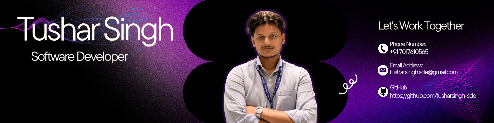

<!-- ═══════════════════════════════════════════════════════════════════════════
     TUSHAR SINGH — GitHub Profile README
     Modern • Clean • Professional
     ═══════════════════════════════════════════════════════════════════════════ -->


<div align="center">

<!-- ──────────────── BANNER ──────────────── -->


<!-- ──────────────── TYPING SVG ──────────────── -->
<br/>

[](https://git.io/typing-svg)

<br/>

<!-- ──────────────── SOCIAL BADGES ──────────────── -->
<a href="https://www.linkedin.com/in/tushar-singh-5037273b4"></a>&nbsp;
<a href="mailto:tusharsingh.sde@gmail.com"></a>&nbsp;
<a href="https://github.com/tusharsingh-sde"></a>

<br/><br/>

<!-- ──────────────── VISITOR COUNTER ──────────────── -->


</div>

<br/>

<!-- ═══════════════════════════════════════════════════════════════════════════ -->

##  &nbsp;About Me

> *"I build AI-powered backends and computer vision systems that actually make it past the local server. I don't just train models in notebooks — I build the fast, scalable APIs, microservices, and containerized architectures that make them usable in the real world."*


- 🎓 **3rd-Year B.Tech CSE** at MIET, AKTU (Class of 2024–2028)
- 🔭 Currently building **SignBridge AI** — real-time sign language translation
- 🧠 Deep-diving into **Agentic AI**, **LangGraph**, and **multi-agent orchestration**
- 🏆 **7+ national hackathon finalist** including **ISRO BAH 2026** & **SIH 2025/2026**
- ⚡ Exploring **Go (Golang)** for ultra-low-latency distributed backends
- 📫 Reach me at **tusharsingh.sde@gmail.com**
- 📍 Meerut, UP / Greater Delhi Area, India

<br clear="both"/>

<!-- ═══════════════════════════════════════════════════════════════════════════ -->

##  &nbsp;Tech Stack

<!-- SCROLLING MARQUEE — Languages & Core -->
<div align="center">

<h4>Languages & Core</h4>

<a href="#"></a>

<h4>Backend & Frameworks</h4>

<a href="#"></a>

<h4>AI / ML & Data Science</h4>

<a href="#"></a>
&nbsp;


<h4>Databases & Storage</h4>

<a href="#"></a>
&nbsp;


<h4>DevOps & Cloud</h4>

<a href="#"></a>

<h4>Frontend</h4>

<a href="#"></a>

</div>

<br/>

<!-- ═══════════════════════════════════════════════════════════════════════════ -->

##  &nbsp;Featured Projects

<div align="center">

<table>
<tr>
<td width="50%" valign="top">

### 🛰️ Antriksha Search Engine (ASE)
**Cross-Modal Satellite Image Retrieval**
<br/><br/>
Bridges SAR & Optical satellite imagery using **RemoteCLIP ViT-B/32** + **FAISS** vector search with sub-0.04s retrieval across 32K+ scene embeddings.
<br/><br/>
`RemoteCLIP` `FAISS` `PyTorch` `Streamlit`
<br/><br/>
[](https://github.com/tusharsingh-sde/ASE-Antrikhsa-Search-Engine)
<br/>


</td>
<td width="50%" valign="top">

### 🛣️ RoadGuard AI
**Smart Pothole Detection & Cost Estimation**
<br/><br/>
Autonomous pothole detection with **YOLOv11 + ByteTrack**, geospatial mapping via Leaflet, automated PDF reports, and full Docker+Azure deployment.
<br/><br/>
`YOLOv11` `FastAPI` `Next.js` `Docker` `Azure`
<br/><br/>
[](https://github.com/tusharsingh-sde/RoadGuardAI)
<br/>


</td>
</tr>

<tr>
<td width="50%" valign="top">

### ⚖️ JurixAI
**RAG-Based Indian Legal Assistant**
<br/><br/>
Empathetic multilingual legal chatbot powered by **Llama 3.3-70B** & **Gemini Flash** with ChromaDB RAG across 8 Indian legal domains. OCR-enabled document analysis.
<br/><br/>
`LangChain` `ChromaDB` `Groq` `Gemini` `React`
<br/><br/>
[](https://github.com/tusharsingh-sde/JurixAI)

</td>
<td width="50%" valign="top">

### 🛡️ HazardLens
**Edge AI Hazard Detection Platform**
<br/><br/>
Real-time dual **YOLOv8** inference for fire/smoke/crowd detection on CCTV feeds with offline Hindi neural voice alerts via **Edge-TTS** — zero cloud dependency.
<br/><br/>
`YOLOv8` `Edge-TTS` `OpenCV` `Streamlit`
<br/><br/>
[](https://github.com/tusharsingh-sde/HazardLens)
<br/>


</td>
</tr>

<tr>
<td width="50%" valign="top">

### ☁️ CloudMask AI
**Satellite Cloud Segmentation + 3D WebGL**
<br/><br/>
Custom **U-Net** for pixel-level cloud masking on Landsat 8 multispectral imagery with mixed-precision training and a **Three.js** 3D Earth orbital viewer.
<br/><br/>
`PyTorch` `U-Net` `FastAPI` `Three.js` `React`
<br/><br/>
[](https://github.com/tusharsingh-sde/CloudMask-AI)

</td>
<td width="50%" valign="top">

### 🤟 SignBridge AI
**Real-Time Sign Language Translation**
<br/><br/>
**MediaPipe** 21-point hand tracking + **Gemini Flash** sentence synthesis with **ZegoCloud WebRTC** video calling and gamified learning modules. *(In Progress)*
<br/><br/>
`MediaPipe` `FastAPI` `Gemini` `WebRTC`
<br/><br/>


</td>
</tr>
</table>

</div>

<br/>

<!-- ═══════════════════════════════════════════════════════════════════════════ -->

##  &nbsp;Hackathon Track Record

<div align="center">

| Event | Achievement | Role |
|:------|:----------:|:-----|
| 🛰️ **ISRO Bharatiya Antariksh Hackathon 2026** | `Grand Finale Qualified` | Lead ML Architect |
| 🛣️ **Smart India Hackathon 2026** | `Finalist` | Full-Stack Lead |
| 🛣️ **Smart India Hackathon 2025** | `Finalist` | Backend Engineer |
| 🛡️ **Build With Bharat 1.0 (Microsoft)** | `Finalist` | Edge AI Lead |
| 📦 **Amazon ML Challenge 2026** | `Team Leader` | ML Pipeline Architect |
| 🏆 **HackSynergy / Bharat Expo / LITHOS / DevGathering** | `Finalist` | Multi-role |

</div>

<br/>

<!-- ═══════════════════════════════════════════════════════════════════════════ -->

##  &nbsp;What I'm Focused On

<div align="center">

```
 🤖  Agentic AI           →  LangGraph, CrewAI, multi-agent orchestration
 🧠  Deep Learning         →  LoRA / QLoRA fine-tuning, diffusion models
 ⚡  Systems Engineering   →  Go (Golang), Kafka, Redis Pub/Sub
 📱  Edge AI               →  TensorRT, ONNX Runtime, INT8 quantization
 🛰️  Geospatial Intel      →  SAR/Optical fusion, disaster mapping
 ⚖️  Legal Tech            →  Accessible AI for citizen empowerment
```

</div>

<br/>

<!-- ═══════════════════════════════════════════════════════════════════════════ -->

##  &nbsp;GitHub Analytics

<div align="center">


<br/><br/>


</div>

<br/>

<!-- ═══════════════════════════════════════════════════════════════════════════ -->

##  &nbsp;Let's Connect

<div align="center">

<a href="https://www.linkedin.com/in/tushar-singh-5037273b4"></a>&nbsp;&nbsp;
<a href="mailto:tusharsingh.sde@gmail.com"></a>&nbsp;&nbsp;
<a href="https://github.com/tusharsingh-sde"></a>

<br/><br/>

<!-- ──────────────── SCROLLING MARQUEE ──────────────── -->


<br/>

<!-- SCROLLING TECH MARQUEE -->
<marquee behavior="scroll" direction="left" scrollamount="6">
    ⚡ Python &nbsp;•&nbsp; FastAPI &nbsp;•&nbsp; PyTorch &nbsp;•&nbsp; YOLO &nbsp;•&nbsp; LangChain &nbsp;•&nbsp; FAISS &nbsp;•&nbsp; Docker &nbsp;•&nbsp; React &nbsp;•&nbsp; Next.js &nbsp;•&nbsp; PostgreSQL &nbsp;•&nbsp; MongoDB &nbsp;•&nbsp; Supabase &nbsp;•&nbsp; Azure &nbsp;•&nbsp; OpenCV &nbsp;•&nbsp; MediaPipe &nbsp;•&nbsp; ChromaDB &nbsp;•&nbsp; Gemini &nbsp;•&nbsp; WebSockets &nbsp;•&nbsp; Three.js &nbsp;•&nbsp;
</marquee>

<br/><br/>


</div>

<!-- ═══════════════════════════════════════════════════════════════════════════ -->
